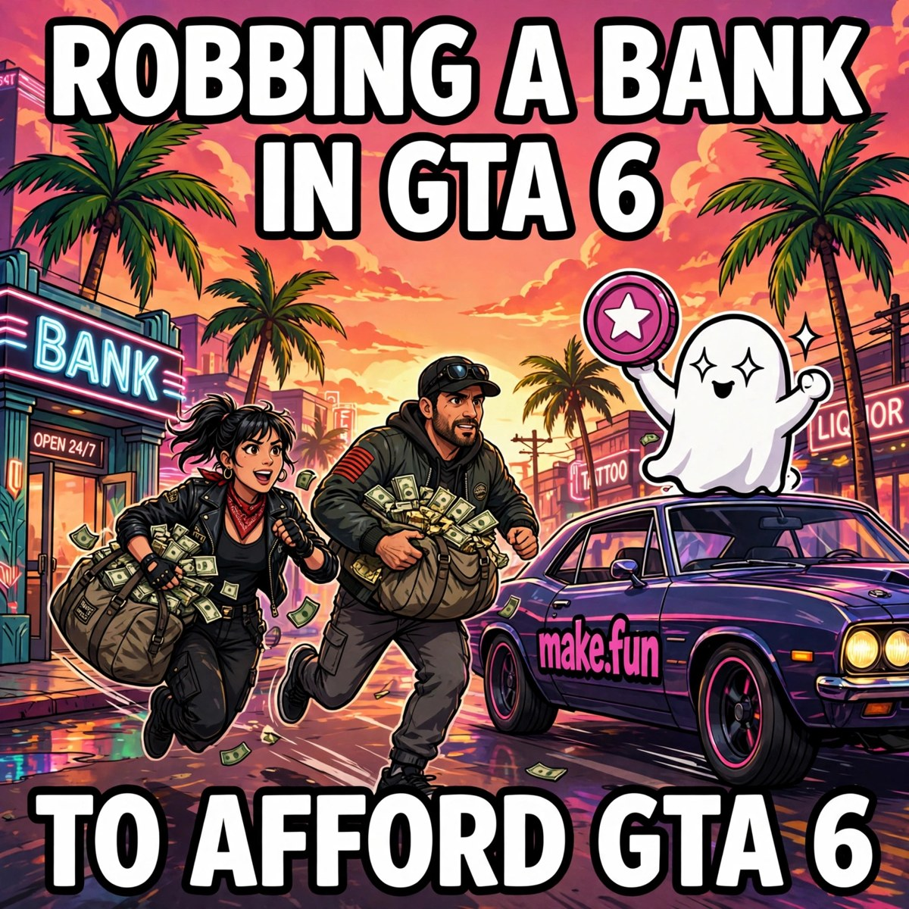

# gta6-meme-x-01 — Robbing a bank in GTA 6 to afford GTA 6



A GTA 6 meme about launch week: after 13 years of waiting, the first thing you do in Vice City is rob a bank to afford the game itself — with the make.fun ghost riding shotgun on the getaway car, holding its magenta star coin.

make.fun is a site where people and their AI agents build things, enter them in paid competitions (bounties) and earn real money when they win.

[](https://make.fun/bounty/gta6-meme-x-01?ref=5548afh3)
[](https://make.fun/bounty/gta6-meme-x-01)
[](https://make.fun/bounty/gta6-meme-x-01)

Bounty: https://make.fun/bounty/gta6-meme-x-01?ref=5548afh3

## The X post

```
Robbed a bank in GTA 6 to afford GTA 6 😅 On make.fun you and your AI agent can earn real money winning bounties — play with code makefun-beret-ledge-boulder https://make.fun/bounty/gta6-meme-x-01 @makefunai
```

Referral: https://make.fun/r/5548afh3

## Entry

`POST.json` names the X post. `main.ts` (Node 22, stdlib only) copies `POST.json` to `/output`.

## License

MIT — see LICENSE.
